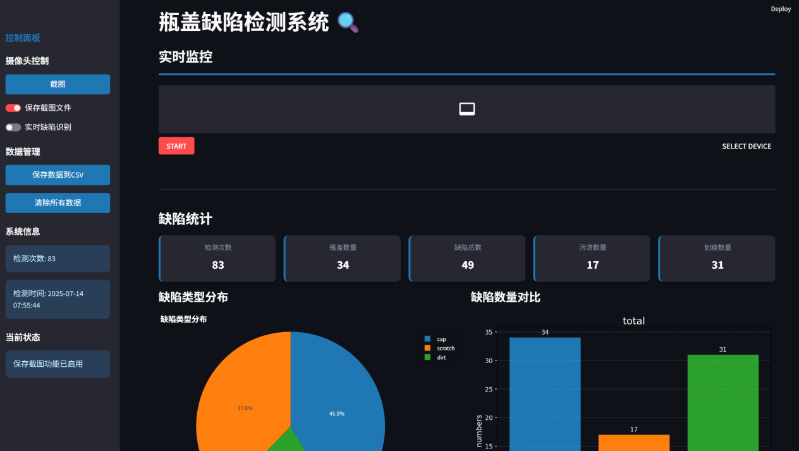

# 瓶盖缺陷检测系统

基于 YOLO 的瓶盖表面缺陷检测演示系统：从摄像头取帧 → 检测缺陷 → 记录结果 → 统计展示。
界面用 Streamlit 搭建，检测用 Ultralytics YOLO，一次点击完成"截图 + 识别 + 入库"。



## 功能

| 功能 | 说明 |
|---|---|
| 摄像头实时画面 | 通过 `streamlit-webrtc` 在浏览器里打开摄像头 |
| 单帧截图 | 点击「截图」抓取当前帧，可保存为 jpg |
| 缺陷检测 | YOLO 对当前帧推理，在图上画框并标注类别与置信度 |
| 结果记录 | 每次检测的每个框写入 CSV（时间、类型、置信度、坐标） |
| 数据统计 | 检测次数、瓶盖数、缺陷总数、污渍数、划痕数五项指标 |
| 图表展示 | 缺陷类型饼图、数量柱状图、按时间分组的趋势柱状图、明细表 |

## 技术栈

- **Python 3.10+**
- **Streamlit** —— 页面与交互
- **streamlit-webrtc** —— 浏览器摄像头取流
- **Ultralytics YOLO** —— 缺陷检测
- **OpenCV** —— 画框、图像读写
- **pandas** —— 记录存取与时间分组统计
- **Plotly / Matplotlib** —— 图表

## 目录结构

```
bottle-cap-defect-detection/
├── app.py              # 页面入口（Streamlit）
├── detector.py         # 模型加载 + 单帧推理 + 画框
├── data_manager.py     # 检测记录的存取与统计
├── image_utils.py      # 截图落盘
├── models/best.pt      # 训练好的权重（5.2 MB）
├── screenshots/        # 界面截图
├── docs/               # 课程设计报告与演示文稿
├── requirements.txt
└── data/               # 运行时生成的 CSV（不入库）
```

## 运行

```bash
pip install -r requirements.txt
streamlit run app.py
```

浏览器会自动打开 `http://localhost:8501`。点击「START」授权摄像头后即可使用。

> WebRTC 需要安全上下文：用 `localhost` 访问没问题，如果从其他机器访问需要 HTTPS。

## 使用流程

1. 侧栏打开「保存截图文件」（可选）与「实时缺陷识别」
2. 点「START」打开摄像头
3. 点「截图」抓取当前帧
   - 勾了保存：图片存到 `images/original/`
   - 勾了识别：模型推理并把结果写入 `data/defect_data.csv`
4. 下方自动刷新五项指标、饼图、柱状图和明细表
5. 需要时可以「保存数据到CSV」或「清除所有数据」

## 数据记录格式

CSV 固定 7 列：

| 列名 | 含义 |
|---|---|
| 时间 | 截图时刻 |
| 类型 | `cap` / `dirt` / `scratch` |
| 置信度 | 0~1 |
| x1, y1, x2, y2 | 检测框坐标 |

默认路径 `data/defect_data.csv`，可用环境变量 `DEFECT_CSV_PATH` 改到别处。

## 关于模型

`models/best.pt` 是已训练好的 YOLO 权重，直接加载即可推理，**不需要重新训练**。
模型内共有 4 个类别：`cap`（瓶盖）、`dirt`（污渍）、`scratch`（划痕）、`hole`（孔洞）。

## 已知限制

- 界面统计只覆盖 `cap` / `dirt` / `scratch` 三类，模型中的 `hole` 类尚未接入统计面板
- 检测是「点一次、算一帧」，不是视频逐帧连续检测
- 训练数据集与训练脚本不在本仓库内，这里只保留推理与界面部分

## 文档

- `docs/report.docx` —— 课程设计报告
- `docs/slides.pptx` —— 演示文稿
