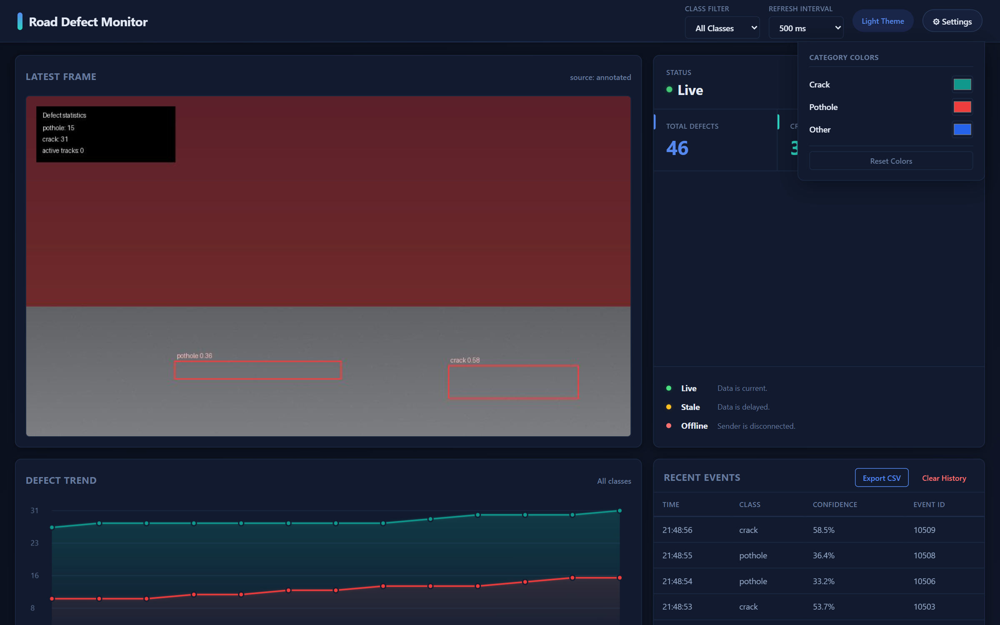

# Road Defect Monitor — 边缘侧道路缺陷检测与可视化

ROS + Webots 仿真环境下的道路缺陷巡检系统：Webots 里跑一台四轮差速小车，ROS 负责导航与视觉检测，
浏览器端实时显示摄像头画面、缺陷统计、趋势曲线与事件列表。


## 系统由三块组成

```
┌─────────────────────────────┐
│  Webots 仿真 (circlerace)   │  环形赛道 + 障碍物 + 车载相机/激光雷达
└──────────────┬──────────────┘
               │ /cmd_vel  →  cmd_vel_to_webots.py  →  四轮电机
               │ 相机图像   →  缺陷检测节点（YOLO）
               ▼
┌─────────────────────────────┐
│  ROS 节点                   │  导航（全局 + TEB 局部）、检测、跟踪去重
└──────────────┬──────────────┘
               │ state.json + latest.jpg
               ▼
┌─────────────────────────────┐
│  Web 面板 (本目录 web/)     │  轮询 /api/status → 画面 / 统计 / 趋势 / 事件
└─────────────────────────────┘
```

## 目录结构

```
road-defect-monitor/
├── web/                         # 可视化面板（可独立运行）
│   ├── index.html               # 主面板
│   ├── check.html               # 前端自检页
│   ├── app.js                   # 轮询、趋势图、事件表、主题与配色设置、CSV 导出
│   ├── styles.css               # 深浅双主题样式
│   └── server.py                # 最小后端：/api/status、/latest.jpg、静态文件
├── ros/
│   └── cmd_vel_to_webots.py     # /cmd_vel → Webots 四轮差速轮速
├── webots/
│   ├── worlds/circlerace.wbt    # 主赛道（含障碍物）
│   ├── worlds/circlerace_wo_obstacles.wbt
│   ├── worlds/2.png             # 赛道地面纹理
│   ├── rviz_config/rviz_config.rviz
│   └── controllers/python_controller/python_controller.py
├── docs/report.docx             # 课程设计报告
└── screenshots/
```

## 快速开始（只跑可视化面板）

面板不依赖 ROS 和模型，用演示数据就能跑起来：

```bash
cd web
pip install -r ../requirements.txt
python server.py --mock
```

浏览器打开 <http://127.0.0.1:8000>，就能看到画面、统计、趋势和事件实时刷新。



## 接口契约

前端只依赖两个接口，后端实现或替换都很容易：

| 接口 | 返回 |
|---|---|
| `GET /api/status` | `{status, age_seconds, counts, has_frame, seq, frame_source, events[]}` |
| `GET /latest.jpg` | 最新一帧（已标注）JPEG |

`status` 由 `age_seconds` 推导：`< 3s` 为 `live`，`< 10s` 为 `stale`，否则 `offline`。
`events[]` 每项为 `{id, class_name, conf}`，前端按 `id` 去重后进入事件表。

## 真实链路怎么接

检测节点每完成一次推理，写两个文件即可，无需改动前端：

```
web/data/state.json    {"ts": 1785..., "seq": 10543, "frame_source": "annotated",
                        "counts": {"crack": 14, "pothole": 4},
                        "events": [{"id": 20, "class_name": "crack", "conf": 0.335}]}
web/data/latest.jpg    标注后的画面
```

然后不带 `--mock` 启动 `server.py` 即可。

## 关于 cmd_vel_to_webots.py

把 ROS 的 `/cmd_vel`（Twist）转成 Webots 四轮差速的轮速，处理链是：

1. **限幅**：线速度、角速度、单轮转速各自钳位
2. **角速度死区**：`|w| < 0.02 rad/s` 直接归零，避免遥控器/规划器的微小噪声导致车原地打转
3. **差速运动学**：`v_left = v - w·L/2`，`v_right = v + w·L/2`，再除以轮半径换成角速度
4. **一阶低通平滑**：`out = α·prev + (1-α)·curr`，α=0.4，防止轮速突变导致打滑

参数默认值与仿真世界是**对齐**的：世界文件里轮子锚点 ±0.15 m（轮距 0.3 m）、轮半径 0.04 m，
正好对应代码里的 `wheel_distance=0.3`、`wheel_radius=0.04`。

## 可视化面板的功能

- 深色/浅色双主题（浅色效果见 `screenshots/dashboard-light.png`）
- 缺陷类别配色自定义（取色器 + 一键重置），存在 localStorage
- 刷新频率可调（250ms ~ 5s）
- 缺陷趋势折线图（Canvas 手绘，含渐变填充与数据点）
- 事件表：按类别筛选、按 ID 去重、一键导出 CSV、清空历史
- 连接状态三档：Live / Stale / Offline，带脉冲动画

## 当前状态（如实说明）

| 部分 | 状态 |
|---|---|
| `web/app.js`、`web/styles.css` | 原项目成果，未改动逻辑（仅把默认主题改回深色） |
| `web/index.html`、`check.html`、`server.py` | 依据 `app.js` 暴露的 DOM 结构与接口契约**重建** |
| `cmd_vel_to_webots.py` | 原项目成果 |
| `webots/` 世界、RViz 配置、自检控制器 | 课程提供的仿真材料 |
| ROS 缺陷检测节点、YOLO 权重 | **未包含**（原始环境已丢失，需重新实现/训练） |
| 地图 `circularrace.png`、`navigation.launch`、TEB 参数 | **未包含**（可由 `slam_gmapping` 与课程模板重新生成） |

演示模式下画面里的"路面"是合成的示意图像，用来验证数据链路与界面，**不是真实检测结果**。

## 已知限制

- 原始检测模型对裂缝过于敏感，无裂缝区域也会误检（报告中有记录），需调高置信阈值或重训
- 面板为单页轮询设计，`seq` 回退时会自动清空趋势历史，不支持多客户端共享历史

## 文档

- `docs/report.docx` —— 课程设计报告
